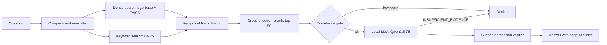

# CiteSEC: Citation-Grounded RAG over SEC Filings

Ask a plain-English question about a company's 10-K or 10-Q and get an answer where every claim points to a filing page. When the retrieved evidence is weak, CiteSEC declines instead of guessing. It is evaluated on the FinanceBench benchmark with a fixed dev and test split, retrieval ablations, and a 60-question refusal set. It runs entirely on one machine with a local 7B model, no paid API.

## What it does

- Searches 207 filings (84 FinanceBench documents plus 123 EDGAR 10-K and 10-Q filings from 40 other companies) with a table-aware chunker, BM25 plus dense retrieval fused by Reciprocal Rank Fusion, and a cross-encoder reranker.
- Answers with a local Qwen2.5 7B model that must cite the page of each claim. Citations that do not point at a retrieved passage are removed.
- Refuses when evidence is weak. A confidence gate calibrated on dev skips the model on low-scoring retrievals, and the model itself replies INSUFFICIENT_EVIDENCE when the passages are about another company or fiscal year.
- Serves a FastAPI endpoint with Prometheus metrics and a Streamlit demo that shows the evidence behind every answer.

## Architecture



## Results

Every number below is generated from `results/*.json` by `scripts/make_report.py`, and `BENCHMARKS.md` has the full tables, the dev split, the judge validation and the caveats.

<!-- RESULTS:START -->
**Retrieval**, FinanceBench test split (100 questions), percent, gold is the exact filing page.

| Pipeline | Hit@5 | MRR | Doc-Hit@5 |
|---|---|---|---|
| Naive chunks + dense (baseline) | 24.0 | 13.5 | 74.0 |
| Structured chunks + dense | 46.0 | 30.7 | 92.0 |
| Structured + hybrid + rerank (open retrieval) | 45.0 | 32.6 | 95.0 |
| Structured + hybrid + rerank + company and year filter | 49.0 | 35.6 | 97.0 |

**Answers**, same split (100 answerable and 41 unanswerable questions), percent. Wrong is the share of answerable questions answered incorrectly. Abstains is the share of unanswerable questions refused.

| System | Accuracy | Wrong answers | Abstains on unanswerable | Valid citations | Latency s p50 / p95 |
|---|---|---|---|---|---|
| Closed-book LLM (baseline) | 20.0 | 77.0 | n/a | n/a | 5.3 / 12.9 |
| Naive RAG | 17.0 | 20.0 | 100.0 | 94.4 | 2.0 / 18.5 |
| CiteSEC (full system) | 39.0 | 27.0 | 100.0 | 95.9 | 2.7 / 16.8 |

Serving latency, 100 answerable queries end to end on NVIDIA GeForce RTX 4060 Laptop GPU with a local 7B model: p50 4.1 s, p95 13.3 s. It is higher than the answer table because the table also counts unanswerable questions, which are mostly refused quickly.
<!-- RESULTS:END -->

How to read these numbers:

- Retrieval Hit@5 means a gold evidence page is among the top 5 chunks. The filter row assumes the question names its company, so use the open-retrieval row for general claims.
- Accuracy is graded by a deterministic number check plus a local LLM judge. The judge was validated on hand labels written by an AI assistant and not yet audited by a person, see `BENCHMARKS.md`.
- Generation is stable within a session but not bit-reproducible across sessions, so treat accuracy as plus or minus 2 points.
- The retrieval stage is the ceiling. When the gold page reaches the model it answers correctly most of the time, and when it does not the system mostly refuses.

## Quickstart

Windows with an NVIDIA GPU and Ollama installed. Python 3.11 or newer.

```powershell
python -m venv .venv
.\.venv\Scripts\python -m pip install torch==2.6.0 --index-url https://download.pytorch.org/whl/cu124
.\.venv\Scripts\python -m pip install -e ".[ml,serve,ui,dev]"
copy .env.example .env        # set EDGAR_IDENTITY="Your Name you@example.com"
ollama pull qwen2.5:7b

.\tasks.ps1 data              # download FinanceBench and EDGAR, parse PDFs and filings
.\tasks.ps1 index             # chunk, embed, build FAISS and BM25 indexes
.\tasks.ps1 serve             # API on http://127.0.0.1:8765  (docs at /docs)
.\tasks.ps1 ui                # Streamlit demo, in a second terminal
```

On Linux or macOS use the same commands through the `Makefile` (`make data index serve`).

Measured on an RTX 4060 laptop GPU with 32 GB RAM: the FinanceBench download takes about 3 minutes, the EDGAR download about 25 minutes, parsing the 84 gold PDFs takes several hours on the CPU, building both indexes takes about 40 minutes, and the API needs about 45 seconds to start. Only the PDF parse is slow and it is cached.

Query the API directly:

```powershell
curl -X POST http://127.0.0.1:8765/query -H "Content-Type: application/json" `
  -d '{"question": "What is Amcor year end FY2020 net AR in USD millions?", "filters": {"companies": ["Amcor"], "years": [2020]}}'
```

The response has the answer, the cited passages with page numbers, whether the system abstained and why, a confidence score and a per-stage latency breakdown. Prometheus metrics are at `/metrics`.

## Reproducing the evaluation

```powershell
.\tasks.ps1 eval              # retrieval ablation on the dev split
.\tasks.ps1 answers-dev      # answer evaluation on dev (needs Ollama, about 25 minutes)
.\tasks.ps1 answers-test     # the one-time test run (about 45 minutes)
.\tasks.ps1 profile          # latency profile
.\tasks.ps1 report           # regenerate BENCHMARKS.md and the table above
.\tasks.ps1 test             # unit tests, no GPU or model needed
```

Rules the evaluation follows: the dev/test split is fixed and seeded, every threshold and design choice was made on dev, and the test split was run once. Choices made after looking at dev results are listed in `docs/phase3-notes.md` and `docs/phase4-notes.md`.

## Repository layout

```
src/citesec/
  ingest/      FinanceBench loader, PDF page parser, EDGAR downloader and section splitter
  chunking/    naive baseline and table-aware structured chunker
  index/       embeddings with cache, FAISS, BM25, SQLite chunk store
  retrieval/   hybrid search, RRF, cross-encoder rerank, company and year filter
  generation/  prompts, Ollama client, citation verifier, abstention gate
  eval/        metrics, judge, answer and retrieval evaluation, report generator
  api/         FastAPI app and Prometheus metrics
  pipeline.py  the full question to answer pipeline shared by API, UI and profiler
app/           Streamlit demo
scripts/       data download, index build, profiling, report generation
docs/          design notes per phase, failure analyses
results/       every number in the report, as JSON
```

## Limitations

- A 7B local model is weak at multi-step arithmetic and at reading dense tables. Numerical reasoning questions score far below fact lookup.
- The gold page reaches the model for only about half of the test questions. Page-level retrieval of financial statements is the main bottleneck, see `docs/retrieval_failures.md`.
- Hybrid search did not beat dense search alone in this setup. BM25 is weak on long conversational questions, and the reranker recovers the difference.
- The refusal set is templated and easy for a model that checks company names. A harder set would be a real company with a plausible but absent figure.
- Page numbers are exact only for the FinanceBench PDFs. EDGAR filings are cited by section.
- The test split has 100 questions, so differences of a few points are within noise.

## What I would do next

- Collapse retrieval results to one chunk per page before taking the top k, and replace the hard year filter with a soft boost.
- Add a calculator tool so arithmetic does not depend on the language model.
- Try a stronger generator and compare, keeping the same evaluation.
- Build a harder unanswerable set and a larger answerable evaluation set.

## Data and citation

SEC filings are public domain. The FinanceBench PDFs and questions are downloaded by `scripts/download_data.py` and are not redistributed here. EDGAR downloads follow the SEC fair access rules, with a declared identity and at most 5 requests per second.

FinanceBench: Islam et al., "FinanceBench: A New Benchmark for Financial Question Answering", 2023. https://arxiv.org/abs/2311.11944

```bibtex
@misc{islam2023financebench,
  title={FinanceBench: A New Benchmark for Financial Question Answering},
  author={Pranab Islam and Anand Kannappan and Douwe Kiela and Rebecca Qian and Nino Scherrer and Bertie Vidgen},
  year={2023},
  eprint={2311.11944},
  archivePrefix={arXiv},
  primaryClass={cs.CL}
}
```
